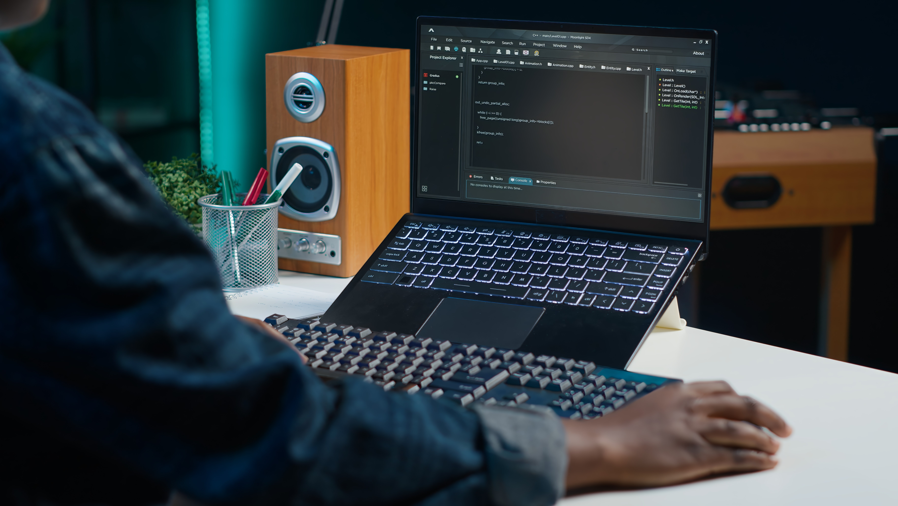

<!-- Banner -->

  

<h1 align="center">Hi, I'm Hamza Ait Mansour 👋</h1>

  <b>Flutter Mobile Engineer · Full-stack (Spring Boot, Node.js) · AWS & Terraform</b> 
  I build Flutter apps, and I ship the API and the cloud they run on too.

  
  

---

## 🚀 About me

State Engineer in Computer Engineering (**ENSA Agadir**) and **Oracle Certified Professional, Java SE 17 Developer**.

I have shipped production software for SaaS companies in Morocco and France (company names kept confidential), in Scrum teams with backend, front-end and mobile engineers, often working directly with the client:

- **Employee-engagement SaaS:** a carpooling module built end to end (11 Flutter screens, Node.js API, PostGIS corridor matching, self-hosted OSRM routing, HMAC-signed QR check-in), plus Events and dynamic Forms modules in Flutter + Firebase.
- **Enterprise intranet portal:** Next.js + NestJS + Keycloak SSO, with the AWS infrastructure written in Terraform (VPC, ALB, ECS, ECR, RDS, WAF, CloudWatch) across Dev, Staging and Prod.
- **Restaurant management SaaS:** kitchen display, self-order kiosk and customer display. Flutter app with offline-first sync and PubNub real-time chat, Java 21 / Spring Boot backend with ~200 endpoints and 2,000+ automated tests.

---

## 🧠 Tech stack

  

| Area | Tools |
|------|-------|
| **Mobile** | Flutter, Dart, Provider / MVVM, Clean Architecture, Dio, Firebase (Firestore, FCM, Analytics), offline-first sync |
| **Backend** | Java 17 / 21, Spring Boot, Spring Security, Spring Cloud, Node.js, NestJS, Prisma, REST, WebSockets |
| **Cloud & DevOps** | AWS (ECS, ECR, RDS, ALB, VPC, WAF, CloudWatch), Terraform, Docker, GitHub Actions CI/CD |
| **Data** | PostgreSQL / PostGIS, MySQL, Redis |
| **Ways of working** | Agile / Scrum, UML, code review, automated tests (JUnit, Vitest, Flutter tests) |

---

## 🔥 Open source & projects

| Project | What it is | Stack |
|---------|------------|-------|
| [**fddp**](https://pub.dev/packages/fddp) · [repo](https://github.com/hamzaaitmansour/fddp_cli) | CLI on pub.dev that generates a full Clean Architecture feature for Flutter (data, domain, presentation) in one command, with Provider, Bloc, Cubit or Riverpod | Dart |
| [**EducazenKids**](https://hamzaaitmansour.github.io/educat-mobile/) | Learning app prototype for an inclusive school: video lessons, quizzes unlocked at 50 %, timetable, families site and staff dashboard | HTML, CSS, JS |
| [**EDUTRAQ**](https://github.com/hamzaaitmansour/EDUTRAQ_app_SPRINGBOOT) | Biometric attendance: ZK9500 fingerprint reader wired to Spring Boot, deployed on AWS ECS with MySQL on RDS | Spring Boot, Spring Security, Docker, AWS |
| [**Spring Cloud microservices**](https://github.com/hamzaaitmansour/smallBankApp-microservices-SPRING-CLOUD) | Microservices practice: Eureka, Gateway, Config Server, Resilience4j | Spring Cloud, Docker |
| [**Flutter push notifications**](https://github.com/hamzaaitmansour/push-notifications-flutter-firebase) | Push notifications with Firebase Cloud Messaging | Flutter, FCM |

**Hackathons:** NASA Space Apps Challenge 2025, Agadir (BioQuest, a search engine over NASA's space-biology research) · Challenge Agadir 2030, "smart city, open to all" (a platform to discover and book the city's sports fields).

---

## 📊 GitHub stats

  
  

  

---

## 🎓 Education & certification

- **ENSA Agadir:** State Engineering Degree in Computer Engineering (2021–2026)
- **Oracle Certified Professional:** Java SE 17 Developer
- **Languages:** Arabic (native), French, English

---

## 📬 Contact

| Type | Info |
|------|------|
| **Email** | hamza.aitmansour@edu.uiz.ac.ma |
| **LinkedIn** | [hamzaaitmansour](https://www.linkedin.com/in/hamzaaitmansour/) |
| **Location** | Rabat, Morocco |

  Open to freelance and full-time work in mobile, backend or cloud. Let's talk about your product.

